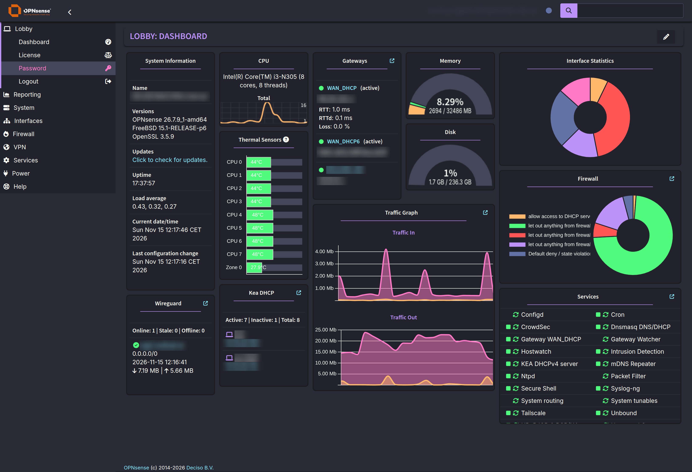
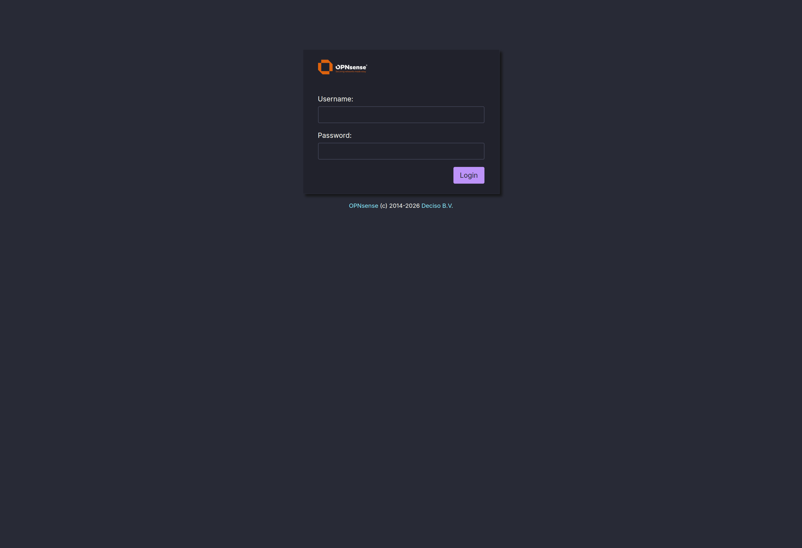
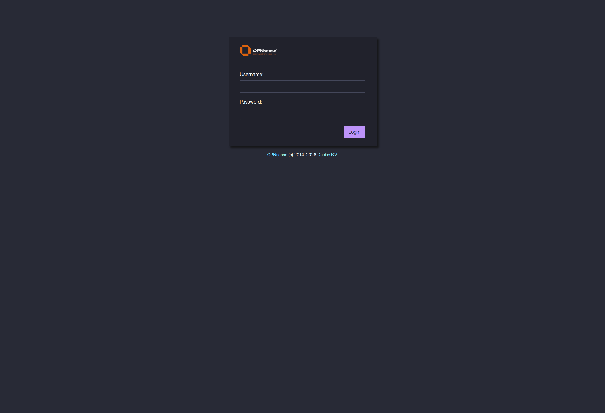
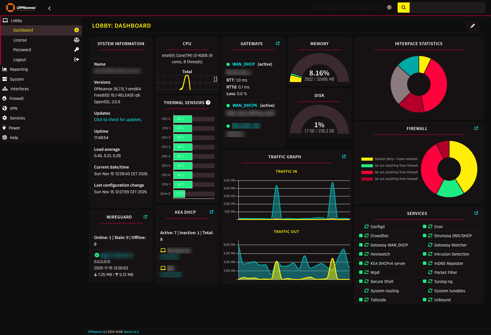
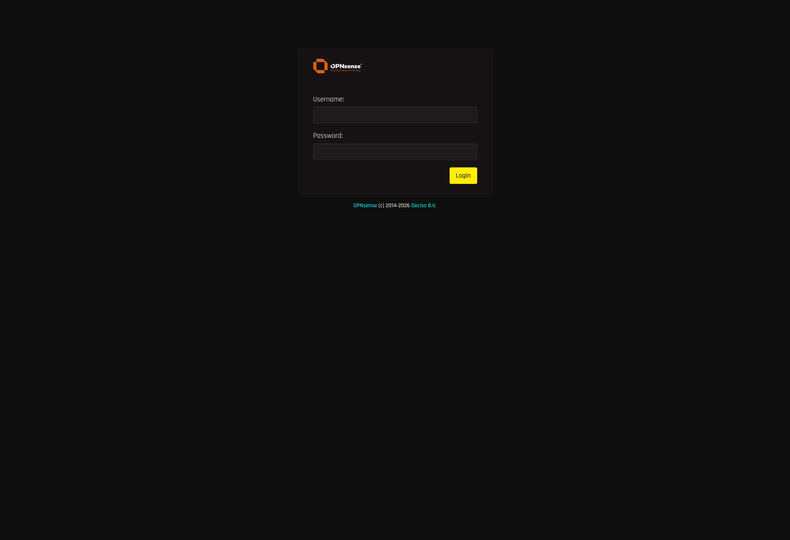

# OPNsense themes by ariamis

Four dark themes for the OPNsense web interface. They are plain theme folders: nothing in OPNsense core is modified, and each one can be removed by selecting another theme and deleting its folder.

Tested on OPNsense 26.7.9_1 (FreeBSD 15.1). Other versions are untested. These are manual, unsupported theme installs, not an official OPNsense package. Try them on a non-production firewall first, and back up your configuration before copying files into `/usr/local/opnsense/www/themes/`.

Download the tarballs and `SHA256SUMS` from the [Releases page](https://github.com/ariamis/opnsense-themes/releases/latest).

## Screenshots

Dashboard and login page of each theme. Hostnames, IP addresses and device names in the dashboard screenshots are blurred.

| Theme | Dashboard | Login |
|---|---|---|
| `dracula-inter` |  |  |
| `dracula-macos` |  |  |
| `nightcity` |  |  |
| `tokyonight` |  |  |

## Themes

| Theme | Palette | Fonts |
|---|---|---|
| `dracula-inter` | Dracula | Inter and Fira Code (bundled) |
| `dracula-macos` | Dracula | System font stack (no Inter, Fira Code or Apple fonts bundled) |
| `nightcity` | Night City (black, yellow, cyan, red) | Rajdhani, Orbitron and Fira Code (bundled) |
| `tokyonight` | Tokyo Night (Night variant) | Inter and Fira Code (bundled) |

Notes on fonts:

- `dracula-macos` uses the system font stack. SF Pro is shown only on Apple devices (macOS and iOS browsers). On Windows and Linux it falls back to Helvetica Neue, Helvetica or Arial. No Apple or SF Pro font files are bundled, and none can be, because of Apple's licence.
- Every theme, including `dracula-macos`, still contains the Source Sans Pro and Glyphicons Halflings font files inherited from the base OPNsense theme.
- All bundled fonts except Glyphicons are under the SIL Open Font License. The licence texts are in each theme's `build/fonts` folder. See [THIRD_PARTY_NOTICES.md](THIRD_PARTY_NOTICES.md) for the exact fonts in each theme.

## What is different from a normal theme

- Charts follow the theme. Each theme ships a small `build/js/theme.js` that recolours the Chart.js widgets (interface statistics, firewall, memory, disk, traffic graph, thermal sensors) and the Smoothie CPU graph. CSS alone cannot do this because these charts are drawn on a canvas.
- The Memory and Disk gauges are fixed so their detail line (for example `1362 / 32486 MB`) is no longer cut off when the font is wider than the default.

## Install (manual, over SSH)

1. Enable SSH in System > Settings > Administration and log in as root or as a user with sudo.
2. Copy the tarball for the theme you want to the firewall, for example with `scp`.
3. Extract it into the themes folder. This creates `/usr/local/opnsense/www/themes/<name>/`:

   ```
   tar -xzf opnsense-theme-tokyonight.tar.gz -C /usr/local/opnsense/www/themes/
   chown -R root:wheel /usr/local/opnsense/www/themes/tokyonight
   ```

4. Select the theme in System > Settings > General > Theme and save.
5. Hard-refresh the browser (Ctrl+Shift+R).

Optional: compare the file with `SHA256SUMS` first, for example with `sha256 opnsense-theme-tokyonight.tar.gz` on the firewall.

## Uninstall

Select another theme in System > Settings > General, then check the exact folder name:

```
ls /usr/local/opnsense/www/themes/
```

Delete only the folder of the theme you installed, for example `tokyonight`. Do not delete the stock themes.

```
rm -rf /usr/local/opnsense/www/themes/tokyonight
```

## After a firmware update

I have not verified whether custom theme folders survive OPNsense firmware updates. After an update, check that the theme can still be selected, and extract the tarball again if its folder is gone.

## Credits and licences

- Base: derived from the OPNsense 26.7.9 theme files (BSD 2-Clause). See `LICENSE.OPNsense` in each theme. This project is not endorsed by the OPNsense project.
- Bundled libraries (bootstrap-select, jQuery Bootgrid, normalize.css, NVD3, Tabulator and others) keep their own licences. See [THIRD_PARTY_NOTICES.md](THIRD_PARTY_NOTICES.md). In each theme, `LICENSE.bootstrap-select` is the bootstrap-select licence (MIT).
- Palettes: [Dracula](https://draculatheme.com) (MIT) and [Tokyo Night](https://github.com/tokyo-night/tokyo-night-vscode-theme) by enkia (MIT). Only the colours are used.
- **Cyberpunk 2077 inspiration:** the `nightcity` theme uses an independently implemented colour scheme inspired by the visual aesthetic of Cyberpunk 2077. It does not include Cyberpunk 2077 game artwork, logos, proprietary fonts or other game assets. This is an unofficial, independently developed project and is not affiliated with, approved by or endorsed by CD PROJEKT RED. Cyberpunk 2077 and related trademarks belong to their respective owners.
- Fonts: Inter, Fira Code, Rajdhani and Orbitron are under the SIL Open Font License 1.1. Source Sans Pro (part of the base theme) has its own licence file.
- The additions in this repository (override CSS and `theme.js`) are released under the BSD 2-Clause licence, see `LICENSE`.

## After installing or updating a theme

OPNsense serves the theme files with the same address every time, so your browser may keep showing the old ones. After copying new files to the firewall, hard-reload every open OPNsense tab (Ctrl+Shift+R, or Ctrl+F5). If a page still looks old, clear the site's cached files once (in Chrome: Ctrl+Shift+Delete, "Cached images and files").

## Build it yourself

There is nothing to compile: the theme folders in `themes/` already contain the finished CSS and JavaScript (the stock OPNsense SCSS was removed in 1.0.1, because it never produced the themed CSS). "Building" means checking the files and packing each theme into an installable tarball. You get the same archives as on the Releases page.

You need a Linux machine (or WSL / macOS with GNU tar) with `bash`, GNU `tar`, `gzip`, `sha256sum` and `node` (only for a JavaScript syntax check). `git` is optional.

1. Get the source, either with git or as a ZIP from the green Code button:

   ```
   git clone https://github.com/ariamis/opnsense-themes.git
   cd opnsense-themes
   ```

2. Build:

   ```
   scripts/package-release.sh
   ```

   The script adds the licence notices to each theme, checks that every font and image referenced by `main.css` exists, checks `theme.js`, and writes `dist/opnsense-theme-<name>.tar.gz` plus `dist/SHA256SUMS`. It stops with an error message if anything is missing.

3. Copy the tarball to the firewall and install it as described under "Install (manual, over SSH)" above, for example:

   ```
   scp dist/opnsense-theme-tokyonight.tar.gz you@firewall:/tmp/
   ```

To change a theme, edit the files in `themes/<name>/build/css/main.css` (and `tokenize2.css`, `build/js/theme.js`) and run the script again. The accessibility check used for releases is described in [ACCESSIBILITY.md](ACCESSIBILITY.md): `python3 -I scripts/a11y-browser-check.py` (needs Python 3 with Playwright and Chromium).
