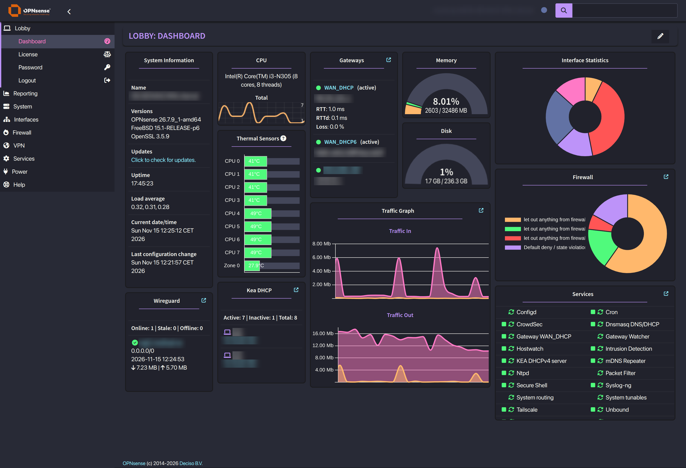
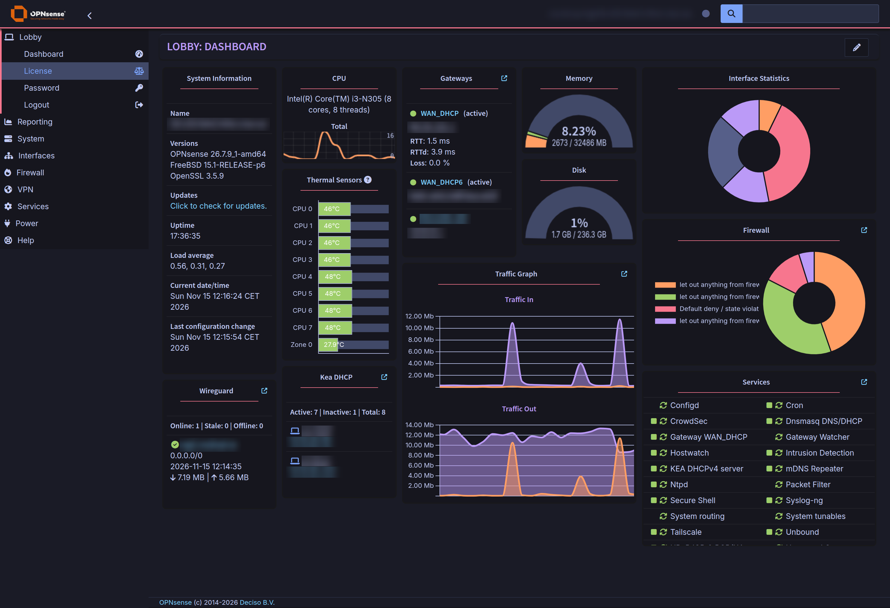
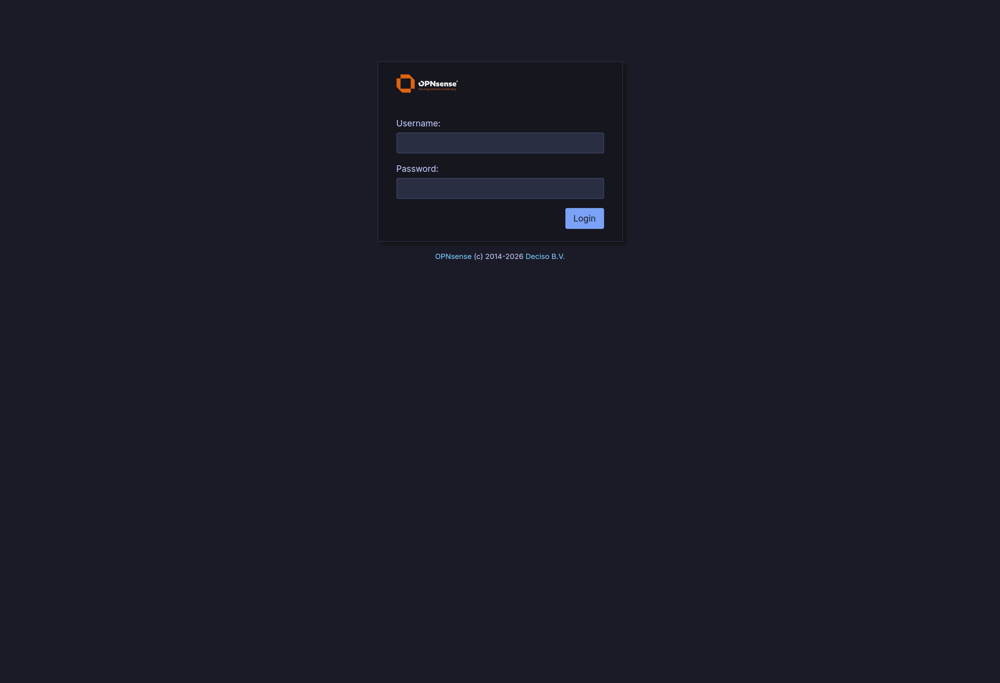

# OPNsense themes by ariamis

Four dark themes for the OPNsense web interface. They are plain theme folders: nothing in OPNsense core is modified, and each one can be removed by selecting another theme and deleting its folder.

Tested on OPNsense 26.7.9_1 (FreeBSD 15.1). Other versions are untested.

## Screenshots

Dashboard and login page of each theme. Hostnames, IP addresses and device names in the dashboard screenshots are blurred.

| Theme | Dashboard | Login |
|---|---|---|
| `dracula-inter` |  |  |
| `dracula-macos` |  |  |
| `nightcity` |  |  |
| `tokyonight` |  |  |

## Themes

| Theme | Palette | Fonts |
|---|---|---|
| `dracula-inter` | Dracula | Inter and Fira Code (bundled) |
| `dracula-macos` | Dracula | System font stack, nothing bundled |
| `nightcity` | Night City (black, yellow, cyan, red) | Rajdhani, Orbitron and Fira Code (bundled) |
| `tokyonight` | Tokyo Night (Night variant) | Inter and Fira Code (bundled) |

Notes on fonts:

- `dracula-macos` uses the system font stack. SF Pro is shown only on Apple devices (macOS and iOS browsers). On Windows and Linux it falls back to Helvetica Neue, Helvetica or Arial. SF Pro cannot be bundled because of Apple's licence.
- All bundled fonts are under the SIL Open Font License. The licence texts are in each theme's `build/fonts` folder.

## What is different from a normal theme

- Charts follow the theme. Each theme ships a small `build/js/theme.js` that recolours the Chart.js widgets (interface statistics, firewall, memory, disk, traffic graph, thermal sensors) and the Smoothie CPU graph. CSS alone cannot do this because these charts are drawn on a canvas.
- The Memory and Disk gauges are fixed so their detail line (for example `1362 / 32486 MB`) is no longer cut off when the font is wider than the default.

## Install (manual, over SSH)

1. Enable SSH in System > Settings > Administration and log in as root or as a user with sudo.
2. Copy the tarball for the theme you want to the firewall, for example with `scp`.
3. Extract it into the themes folder. This creates `/usr/local/opnsense/www/themes/<name>/`:

   ```
   tar -xzf opnsense-theme-tokyonight.tar.gz -C /usr/local/opnsense/www/themes/
   chown -R root:wheel /usr/local/opnsense/www/themes/tokyonight
   ```

4. Select the theme in System > Settings > General > Theme and save.
5. Hard-refresh the browser (Ctrl+Shift+R).

Optional: compare the file with `SHA256SUMS` first, for example with `sha256 opnsense-theme-tokyonight.tar.gz` on the firewall.

## Uninstall

Select another theme in System > Settings > General, then delete the folder:

```
rm -rf /usr/local/opnsense/www/themes/<name>
```

## After a firmware update

I have not verified whether custom theme folders survive OPNsense firmware updates. After an update, check that the theme can still be selected, and extract the tarball again if its folder is gone.

## Credits and licences

- Base: derived from the OPNsense theme files (BSD 2-Clause). See `LICENSE.OPNsense` in each theme. The original `LICENSE` file in each theme belongs to a bundled library (bootstrap-select, MIT).
- Palettes: Dracula (MIT) and Tokyo Night by enkia (MIT). Only the colours are used.
- `nightcity` uses colours inspired by the Cyberpunk 2077 interface. It is an unofficial fan project and is not affiliated with or endorsed by CD PROJEKT RED. No logos, artwork or game assets are used.
- Fonts: Inter, Fira Code, Rajdhani and Orbitron are under the SIL Open Font License 1.1. Source Sans Pro (part of the base theme) has its own licence file.
- The additions in this repository (override CSS and `theme.js`) are released under the BSD 2-Clause licence, see `LICENSE`.
